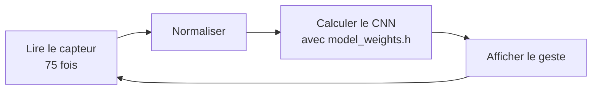

Une fois entraîné sur l'ordinateur, le modèle doit tourner sur un **ESP32** :
une petite carte avec peu de mémoire.

## Rendre le modèle plus léger

On peut stocker chaque paramètre avec moins de précision. C'est la
**quantization**.

| Version | Chaque paramètre | Taille | Accuracy |
| --- | --- | --- | --- |
| float32 | 4 octets | 103 Ko | 100 % |
| float16 | 2 octets | 55 Ko | 100 % |
| **int8** | **1 octet** | **31 Ko** | **100 %** |

:::tip[Image mentale]
C'est comme arrondir des prix au centime au lieu du millième : on perd un peu
de précision, mais le résultat ne change pas.
:::

## Exporter vers Arduino

Le notebook écrit automatiquement les paramètres du modèle dans un fichier C :
`arduino/reconnaissance_mouvement/model_weights.h`.

```c title="model_weights.h (extrait)"
#define N_AXES 6
#define N_STEPS 75
#define N_CLASSES 3
static const char* CLASSES[N_CLASSES] = {"circle", "horizontal", "vertical"};
static const float conv1_w[960] = { 2.799e-01f, 3.789e-01f, ... };
```

Deux astuces rendent la carte plus rapide :

- **La BatchNorm est fusionnée** dans les convolutions : un calcul en moins à
  chaque mesure.
- **Un enregistrement de test** est inclus avec la réponse attendue de
  PyTorch : la carte peut vérifier toute seule qu'elle calcule la même chose.

## Sur la carte, en temps réel


