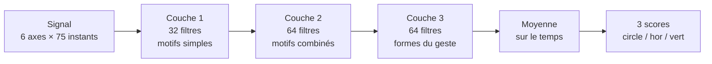

On utilise un **CNN** (réseau de neurones convolutif) à une dimension. C'est
le même principe que pour reconnaître des images, mais appliqué à un signal
dans le temps.

## L'idée : des petites loupes qui glissent sur le signal

Un CNN utilise des **filtres** : de petites fenêtres (5 instants de large) qui
glissent le long du signal. Chaque filtre apprend à repérer un motif simple :
« ça monte », « ça redescend », « les deux axes bougent ensemble »…



Plus on avance dans les couches, plus les motifs reconnus sont **complexes** :
d'abord des petites pentes, puis des bosses, puis la forme complète d'un geste.

## Les briques utilisées

| Brique | Rôle en une phrase |
| --- | --- |
| `Conv1d` | Le filtre qui glisse et cherche un motif. |
| `BatchNorm` | Garde les valeurs à une échelle stable, l'apprentissage est plus rapide. |
| `ReLU` | Ne garde que les motifs détectés (met le reste à zéro). |
| `MaxPool` | Divise la longueur par 2 en gardant l'essentiel. |
| `AdaptiveAvgPool` | Fait la moyenne sur tout le temps : peu importe *quand* le motif apparaît. |
| `Dropout` | Éteint des neurones au hasard pendant l'apprentissage pour éviter le « par cœur ». |
| `Linear` | Transforme tout ça en 3 scores, un par geste. |

## Taille du modèle

Le modèle contient environ **24 000 paramètres** (les nombres appris). C'est
minuscule comparé aux modèles d'IA modernes, et c'est voulu : il doit tenir
sur une petite carte.

```python
class CNN(nn.Module):
    def __init__(self, n_axes=6, n_classes=3):
        super().__init__()
        self.features = nn.Sequential(
            nn.Conv1d(n_axes, 32, 5, padding=2), nn.BatchNorm1d(32), nn.ReLU(), nn.MaxPool1d(2),
            nn.Conv1d(32, 64, 5, padding=2),     nn.BatchNorm1d(64), nn.ReLU(), nn.MaxPool1d(2),
            nn.Conv1d(64, 64, 3, padding=1),     nn.BatchNorm1d(64), nn.ReLU(),
            nn.AdaptiveAvgPool1d(1),
        )
        self.classifier = nn.Sequential(nn.Flatten(), nn.Dropout(0.3), nn.Linear(64, n_classes))
```
