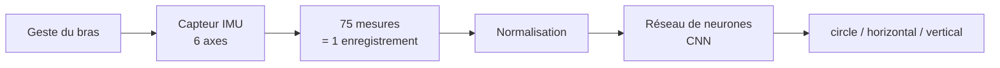

import { Steps } from '@astrojs/starlight/components';

L'objectif : **reconnaître automatiquement un geste du bras** grâce à un petit
capteur de mouvement, directement sur une carte électronique, sans ordinateur.

## Le chemin complet

<Steps>

1. **On fait un geste.** Le capteur, attaché au bras, mesure le mouvement.

2. **Le capteur prend 75 mesures.** À chaque instant, il note 6 valeurs :
   l'accélération et la rotation sur 3 axes.

3. **On met les mesures à la même échelle.** Peu importe que le geste soit fort
   ou doux, on garde seulement sa *forme*.

4. **Le réseau de neurones regarde la forme du signal** et donne une
   probabilité pour chaque geste.

5. **On garde le geste le plus probable.** Par exemple : `circle` à 99,7 %.

</Steps>

## Deux phases bien distinctes

| Phase | Où ? | Ce qui se passe |
| --- | --- | --- |
| **Entraînement** | Sur l'ordinateur (notebook Jupyter) | Le modèle apprend à partir de milliers d'exemples étiquetés. |
| **Utilisation** | Sur la carte (ESP32) | Le modèle déjà appris reconnaît les nouveaux gestes en temps réel. |

:::tip[À retenir]
L'ordinateur sert à **apprendre**, la carte sert à **reconnaître**. On transfère
seulement le résultat de l'apprentissage (les « poids » du modèle) vers la
carte.
:::
